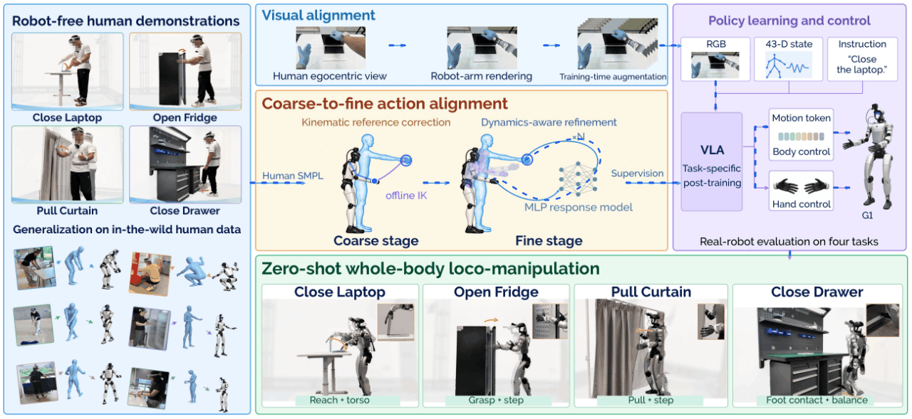

<a href="https://opendrivelab.com/EgoHumanoid-V2/#overview">
  
</a>

<h1 align="center">EgoHumanoid-V2</h1>

<div align="center">

[](https://arxiv.org/abs/2609.37181)
[](https://opendrivelab.com/EgoHumanoid-V2/)
[](https://opendrivelab.com/EgoHumanoid-V2/assets/videos/project-overview-v14.mp4)
[](LICENSE)
[](https://jinchen0056.github.io/)
[](mailto:cj65000816081@gmail.com)

</div>

<p align="center">
  <strong>🤖 Human-to-humanoid skill transfer for coordinated whole-body loco&#8209;manipulation.</strong>
</p>

Human demonstrations capture rich whole-body motion across diverse scenes without robot teleoperation. **EgoHumanoid-V2** transfers these coordinated skills to a humanoid through coarse-to-fine action alignment: kinematic reference correction improves motion targets, and dynamics-aware refinement improves their execution through a frozen whole-body controller.

Visual alignment replaces human arms with rendered robot arms, while training-time image augmentation improves viewpoint robustness. A **π₀.₅ vision-language-action policy** learns from the aligned demonstrations and executes through **Unitree G1 + BrainCo Revo2 + the SONIC whole-body controller**. The paper evaluates zero-shot transfer on four real-world tasks without target-task robot demonstrations.

---

<p></p>

<a id="todo"></a>

### Workflow & Release Checklist

> **Coming soon:** The remaining unchecked items are expected to be released within the next two weeks. Stay tuned!

1. **Hardware Setup**
   - [x] [Robot Hardware](#robot-hardware)
   - [x] [Human Hardware](#human-data-collection-hardware)
2. **Environment Setup**
   - [x] [Robot Control](#robot-runtime-environment)
   - [x] [Human Data Collection](#human-collection-environment)
   - [x] [Policy Training & Serving](#policy-environment)
3. **Data Collection**
   - [x] [Human Collection](#human-data-collection)
4. **Data Alignment**
   - [x] **[Action Alignment](#action-alignment)** ⭐
   - [ ] [Vision Alignment](#vision-alignment)
5. **Model Training**
   - [ ] Training pipeline
6. **Policy Deployment**
   - [ ] Deployment pipeline

---

<p></p>

<a id="hardware-setup"></a>

## 🛠️ Hardware Setup

<table width="100%">
<tr>
<td width="50%" valign="top">
<a id="human-data-collection-hardware"></a>
<h3>Human Hardware</h3>

<details>
<summary>🔴 <strong>PICO 4 Ultra</strong></summary>

- **Tracking:** [PICO 4 Ultra](https://www.picoxr.com/global/products/pico4-ultra) + trackers<br>for whole-body and hand tracking
- **Software:** XRobo&#8203;Toolkit<br>[Setup&nbsp;guide](https://github.com/NVlabs/GR00T-WholeBodyControl/blob/main/docs/source/getting_started/vr_teleop_setup.md#step-1-install-xrobotoolkit) · [Python&nbsp;SDK](https://github.com/XR-Robotics/XRoboToolkit-PC-Service-Pybind)
- **Connec&#8203;tion:** same LAN as the PC<br>enable Head, Hand and Send

</details>
<br>
<details>
<summary>🔵 <strong>5× PICO Trackers</strong></summary>

- **Placement:** five trackers<br>both wrists, waist and both ankles
- **Calibration:** PICO Motion Tracker<br>pair and calibrate in the app ([guide](https://github.com/NVlabs/GR00T-WholeBodyControl/blob/main/docs/source/getting_started/vr_teleop_setup.md#motion-tracker-calibration))
- **Mode:** Full Body in XRobo&#8203;Toolkit<br>enable Hand tracking ([setup&nbsp;guide](https://github.com/NVlabs/GR00T-WholeBodyControl/blob/main/docs/source/getting_started/vr_teleop_setup.md#step-4-connect-the-pico-to-your-workstation))

</details>
<br>
<details>
<summary>🟠 <strong>GoPro</strong></summary>

- **Mount:** neck-mounted bracket<br>Example: [JD listing](https://item.jd.com/product/5qVT4d95gaChewMJeYVDKQ.html)
- **Alignment:** match height, pitch and framing to the robot camera
- **Connec&#8203;tion:** Bluetooth pairing and WiFi setup;<br>WiFi / COHN recording and download ([API](https://github.com/gopro/OpenGoPro))

</details>
</td>
<td width="50%" valign="top">
<a id="robot-hardware"></a>
<h3>Robot Hardware</h3>

<details>
<summary>🟢 <strong>Unitree G1</strong></summary>

- **Platform:** [Unitree G1](https://www.unitree.com/g1/), 29 body DOF<br>excluding hands ([joint&nbsp;layout](https://github.com/unitreerobotics/unitree_rl_gym/blob/main/resources/robots/g1_description/README.md))
- **Control:** [SONIC whole-body controller](https://github.com/NVlabs/GR00T-WholeBodyControl)<br>runs on an external Linux PC
- **Connec&#8203;tion:** wired or WiFi to the PC<br>via the ZMQ bridge

</details>
<br>
<details>
<summary>🔵 <strong>BrainCo Revo2</strong></summary>

- **Hand:** 6 active DOF per hand<br>11 including passive joints ([specs](https://brainco.tech/docs/revolimb-hand/en/revo2/parameters.html))
- **Software:** [official&nbsp;SDK](https://github.com/BrainCoTech/brainco-hand-sdk)<br>hand control and state feedback
- **Mount:** custom G1–Revo2 adapters<br>STL: [part 1](hardware/Revo2-G1-1.stl) · [part 2](hardware/Revo2-G1-2.stl)

</details>
<br>
<details>
<summary>🟠 <strong>GoPro</strong></summary>

- **Mount:** head-mounted bracket<br>STL: [part 1](hardware/G1_GoPro_1.stl) · [part 2](hardware/G1_GoPro_2.stl)
- **Alignment:** match height, pitch and framing to the human camera
- **Connec&#8203;tion:** USB control and video to robot;<br>wired / WiFi forwarding to host ([API](https://github.com/gopro/OpenGoPro))

</details>

</td>
</tr>
</table>

<p></p>

<a id="environment-setup"></a>

## 💻 Environment Setup

We use three separate environments: one for robot control; one for collecting human demonstrations; and one for policy training and serving.

<a id="prerequisites"></a>

<a id="installation"></a>

<a id="robot-runtime-environment"></a>

<details>
<summary>🤖 <strong>Robot Control</strong></summary>

### Host

Ubuntu 22.04 · NVIDIA driver **580+**.

**1. Install dependencies.**

```bash
sudo apt-get update
sudo apt-get install -y --no-install-recommends ca-certificates curl build-essential cmake git git-lfs libgl1 libegl1 libegl-mesa0 libglib2.0-0 ffmpeg libyaml-cpp-dev libeigen3-dev libmsgpack-dev libzmq3-dev nlohmann-json3-dev libssl-dev zlib1g-dev
curl -LsSf https://astral.sh/uv/0.11.14/install.sh | sh
source "$HOME/.local/bin/env"
curl -fL https://developer.download.nvidia.com/compute/cuda/repos/ubuntu2204/x86_64/cuda-keyring_1.1-1_all.deb -o /tmp/cuda-keyring.deb
sudo dpkg -i /tmp/cuda-keyring.deb
sudo apt-get update
sudo apt-get install -y --no-install-recommends cuda-minimal-build-12-4
```

**2. Install TensorRT and ONNX Runtime.** Download `TensorRT-10.13.3.9.Linux.x86_64-gnu.cuda-13.0.tar.gz` from [NVIDIA](https://developer.nvidia.com/tensorrt/download) to the repository root, then run:

```bash
sudo tar -xzf TensorRT-10.13.3.9.Linux.x86_64-gnu.cuda-13.0.tar.gz -C /opt
curl -fL https://github.com/microsoft/onnxruntime/releases/download/v1.16.3/onnxruntime-linux-x64-1.16.3.tgz -o /tmp/onnxruntime.tgz
sudo tar -xzf /tmp/onnxruntime.tgz -C /opt
```

**3. Install environment.** Repeat the exports when opening a new terminal.

```bash
export TensorRT_ROOT=/opt/TensorRT-10.13.3.9
export onnxruntime_ROOT=/opt/onnxruntime-linux-x64-1.16.3
export CUDAToolkit_ROOT=/usr/local/cuda-12.4
export LD_LIBRARY_PATH="$TensorRT_ROOT/lib:$onnxruntime_ROOT/lib:$CUDAToolkit_ROOT/lib64${LD_LIBRARY_PATH:+:$LD_LIBRARY_PATH}"
bash setup/robot/install_host.sh
```

**4. Activate environment.**

```bash
source sonic/.venv/bin/activate
```

### Robot

ARM64 · Ubuntu 20.04 · ROS 2 Foxy · Python 3.8.

**1. Install environment.**

```bash
sudo apt-get update
sudo apt-get install -y python3-dev python3-venv build-essential cmake git python3-colcon-common-extensions ros-foxy-rmw-cyclonedds-cpp ros-foxy-rosidl-generator-dds-idl libyaml-cpp-dev libssl-dev libgl1 libglib2.0-0
bash setup/robot/install_robot.sh
```

**2. Activate environment.**

```bash
source /opt/ros/foxy/setup.bash
source .venv-robot/ros_ws/install/setup.bash
source .venv-robot/bin/activate
```

</details>
<br>
<a id="human-collection-environment"></a>

<details>
<summary>👤 <strong>Human Data Collection</strong></summary>

<p></p>
<p>Ubuntu 22.04 · Python 3.10.</p>

**1. Install environment.**

```bash
sudo apt-get update
sudo apt-get install -y ca-certificates python3.10-dev python3.10-venv build-essential cmake git ffmpeg bluez network-manager
bash setup/human/install.sh
```

**2. Activate environment.**

```bash
source .venv-human/bin/activate
```

</details>
<br>
<a id="policy-environment"></a>

<details>
<summary>🧠 <strong>Policy Training &amp; Serving</strong></summary>

<p></p>
<p>Ubuntu 22.04 · NVIDIA GPU and driver.</p>

**1. Install dependencies.**

```bash
sudo apt-get update
sudo apt-get install -y --no-install-recommends ca-certificates curl git build-essential libgl1 libglib2.0-0
curl -LsSf https://astral.sh/uv/0.11.14/install.sh | sh
source "$HOME/.local/bin/env"
```

**2. Install [OpenPI](https://github.com/Physical-Intelligence/openpi#installation).**

```bash
bash setup/policy/install.sh
```

**3. Activate environment.**

```bash
source openpi/.venv/bin/activate
```

</details>

<p></p>

<a id="data-collection"></a>

## 🎥 Data Collection

<a id="human-data-collection"></a>

### 👤 Human Data Collection

**1. Prepare devices.**

Connect the host and PICO headset to the same network. Start the XRoboToolkit PC service on the host and the XRoboToolkit app on the headset, then enable body and hand tracking. Turn on the GoPro, enable Bluetooth pairing and select Video mode; the collector connects it to the host's WiFi network in the next step.

**2. Start recording.**

```bash
eh2-collect-human --task-name "{task_name}" --task "{task_instruction}"
```

Open `http://127.0.0.1:8080`. Enter the host's WiFi credentials if needed, then click **Prepare collection → Start recording → Save episode / Discard episode**. Wait for saving before recording again. Episodes are saved in LeRobot format to `data/{task_name}/`; new recordings append to the dataset.

**3. Check and synchronize data.**

```bash
eh2-sync-human --root "data/{task_name}"
```

Checks the recordings, synchronizes motion and video at 50 Hz, then checks the output. Results are saved to `data/{task_name}_synced/`, with synchronization and data quality reports in `meta/`.

<p></p>

<a id="data-processing"></a>
<a id="data-alignment"></a>

## ⚡ Data Alignment

<a id="action-alignment"></a>

### 🦾 Action Alignment

We provide one example trajectory for each of the four tasks in [examples](data_alignment/action_alignment/examples). The simulation replays below compare these trajectories before (left) and after (right) alignment.

<table>
<tr>
<td width="50%">

https://github.com/user-attachments/assets/ea461aca-9635-46b3-b522-6a3471bf7dc6

</td>
<td width="50%">

https://github.com/user-attachments/assets/68c5a826-4416-4180-a525-5b584e38e250

</td>
</tr>
<tr>
<td width="50%">

https://github.com/user-attachments/assets/906522e9-1088-4619-9d0f-6d2844623d29

</td>
<td width="50%">

https://github.com/user-attachments/assets/71c1de99-8f2e-4ee1-875c-fe4be36db618

</td>
</tr>
</table>

**1. Align motion.**

Place the input recording at `{task_name}/input.parquet`. Set `{endpoints}` to `hands` for hand alignment or `feet` for foot alignment.

```bash
eh2-align \
  --input "{task_name}/input.parquet" \
  --endpoints {endpoints} \
  --output "results/{task_name}"
```

Results are saved under `results/{task_name}/`: `data.parquet` contains the human SMPL motion and aligned tokens; `run.json` records per-round metrics and the selected round.

**2. Replay motion.**

**SMPL replay:** encode the human motion online to simulate before alignment.

```bash
eh2-replay \
  --input "{task_name}/data.parquet" \
  --mode smpl \
  --output "results/{task_name}/before"
```

**Token replay:** replay the aligned motion tokens to simulate after alignment.

```bash
eh2-replay \
  --input "{task_name}/data.parquet" \
  --mode token \
  --output "results/{task_name}/after"
```

Each command saves `replay.mp4` in its output directory. Results may vary slightly between runs.

<a id="vision-alignment"></a>

### 🎨 Vision Alignment

Coming soon.

<p></p>

<a id="model-training"></a>

## 🤖 Model Training

Coming soon.

<p></p>

<a id="deployment"></a>

## 🚀 Policy Deployment

Coming soon.

<p></p>

<a id="citation"></a>

## 📝 Citation

If you use this work, please cite:

```bibtex
@article{chen2026egohumanoidv2,
  title={{EgoHumanoid-V2}: Human-to-Humanoid Transfer of Coordinated Whole-Body Skills for Loco-Manipulation},
  author={Chen, Jin and Jiang, Yiming and Xu, Chongyang and Shi, Modi and Peng, Shijia and Chen, Li and Li, Tianyu and Xu, Mu and Chen, Yilun and Hoi, Steven and Li, Hongyang},
  journal={arXiv preprint arXiv:2609.37181},
  year={2026}
}
```

---

<p></p>

<a id="acknowledgments"></a>

## 🙏 Acknowledgments

We sincerely thank the following projects and teams:

Presentation media comes from the [EgoHumanoid-V2 project page](https://opendrivelab.com/EgoHumanoid-V2/) and paper; assets retain their owners' rights.

| [](https://github.com/Physical-Intelligence/openpi) | [](https://github.com/NVlabs/GR00T-WholeBodyControl) | [](https://github.com/XR-Robotics/XRoboToolkit-Unity-Client) | [](https://github.com/gopro/OpenGoPro) |
| :---: | :---: | :---: | :---: |
| VLA&nbsp;models | Whole-body&nbsp;control | PICO&nbsp;tracking | GoPro&nbsp;interface |

---

## Contact

Questions, ideas, or interested in collaborating? We'd love to hear from you—feel free to connect with Jin Chen on WeChat!

<p align="center">
  <a href="assets/wechat.png"></a>
</p>
